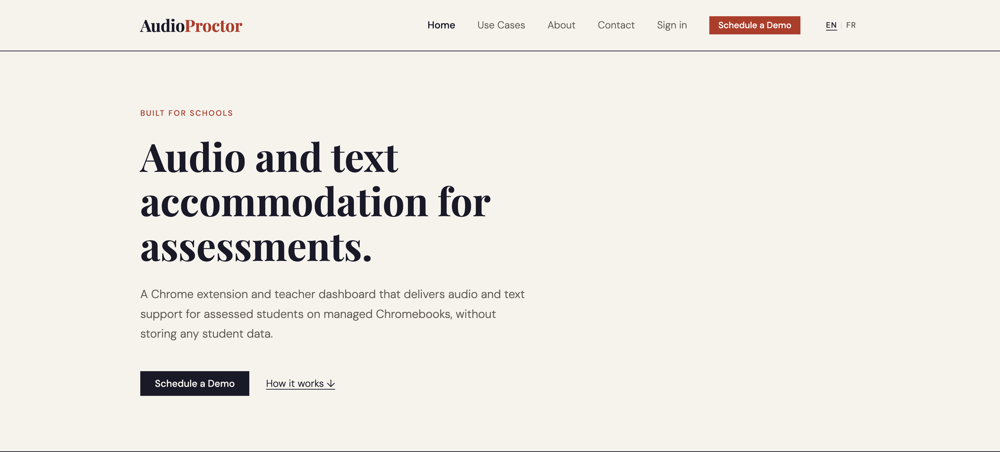
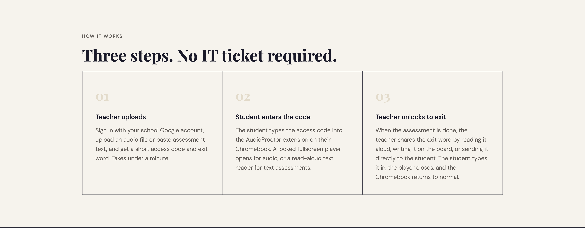
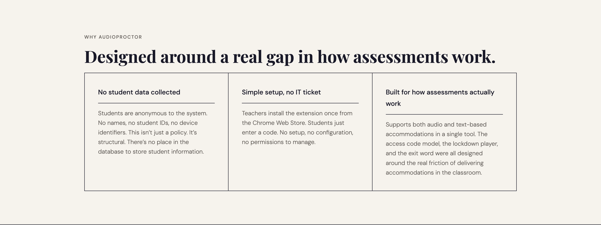

# AudioProctor

Audio and text accommodation for assessments on managed Chromebooks.

Teachers create an assessment by uploading an audio file or pasting text with inline images, then get a short access code. The student enters the code into the Chrome extension on their Chromebook. For audio, a locked fullscreen player opens. For text, a fullscreen reader with built-in read-aloud opens. When the assessment is done, the teacher provides an exit word to close the session.

No student accounts. No student data. No IT ticket per assessment.

Live at [audioproctor.com](https://audioproctor.com). Teachers use it; the Chrome
extension is published; the Chrome Web Store listing is in the deployment section below.

---

## What it looks like







---

## Architecture

Two domains, one Vercel deployment:

| Domain | Content |
|--------|---------|
| `audioproctor.com` | Marketing site (`index.html`, `site/`) |
| `app.audioproctor.com` | Teacher app (`login.html`, `dashboard.html`, etc.) |

`vercel.json` rewrites clean URLs (`/about`, `/contact`, `/request-access`, etc.) to their `site/*.html` counterparts. No host-based routing.

**Stack:** Vanilla HTML/CSS/JS · Vercel serverless functions · Supabase (Postgres + Storage + Auth) · Stripe · Resend · Chrome Extension (Manifest V3)

---

## Local development

```bash
# Install dependencies (Stripe, Resend, Supabase client)
npm install

# Start local dev server (reads .env.local)
vercel dev
```

The extension must be loaded unpacked from `chrome://extensions` for local testing. There is no build step.

### Required environment variables

Create `.env.local` with:

```
SUPABASE_URL=
SUPABASE_ANON_KEY=
SUPABASE_SERVICE_ROLE_KEY=
RESEND_API_KEY=
CONTACT_EMAIL=
STRIPE_SECRET_KEY=
STRIPE_WEBHOOK_SECRET=
STRIPE_PRICE_ID=
```

---

## Project structure

```
/
├── index.html                  # Marketing homepage (served from site/index.html via vercel.json)
├── vercel.json                 # URL rewrites, routes, headers
├── package.json                # Dependencies (Stripe, Resend, Supabase)
│
├── site/                       # Marketing site pages
│   ├── index.html              # Homepage
│   ├── about.html
│   ├── contact.html
│   ├── request-access.html     # Teacher access request form
│   ├── use-cases.html
│   ├── privacy.html
│   ├── terms.html
│   ├── nav.js                  # Shared nav/footer injected on every marketing page
│   ├── js/i18n.js              # Marketing site i18n (language detection, toggle, locale loading)
│   ├── locales/                # Marketing site locale JSON files (en.json, fr.json)
│   └── site.css                # Marketing-only styles
│
├── app/                        # Teacher-facing application
│   ├── login.html              # Google OAuth sign-in
│   ├── dashboard.html          # Teacher upload dashboard
│   ├── player.html             # Web-based player (fallback)
│   ├── admin.html              # Platform admin dashboard
│   ├── school-admin.html       # School admin dashboard
│   ├── division-admin.html     # Division admin dashboard
│   ├── settings.html           # Teacher profile + subscription settings
│   ├── accept-invite.html      # Invitation acceptance flow
│   ├── css/styles.css          # Full design system (app + shared)
│   └── js/
│       ├── auth.js             # Shared auth helpers (requireAuth, ensureProfile, getEffectiveTier)
│       ├── supabase-client.js  # Supabase client initialisation
│       ├── i18n.js             # Core i18n: t(), getLocale(), setLocale(), localechanged event
│       ├── language-toggle.js  # EN|FR toggle in top-bar nav, localStorage + server persistence
│       ├── dashboard-state.js  # Shared constants, exit word lists, module state
│       ├── dashboard-utils.js  # escapeHtml, formatExpiry, file helpers, notices, progress
│       ├── dashboard-access-codes.js  # Code generation, exit word picking, hashWord
│       ├── dashboard-audio.js  # WAV-to-MP3 conversion via lamejs
│       ├── dashboard-editor.js # Contenteditable editor, image paste/drop, assessment type toggle
│       ├── dashboard-upload.js # Upload handler, inline image upload, duplicate, retry normalize
│       ├── dashboard-table.js  # Uploads table rendering, insights, CSV export, rename/expiry/delete
│       ├── dashboard-quota.js  # Quota display, tier badges, trial banners, Stripe upgrade, first login
│       ├── onboarding.js       # First-visit tutorial wizard: 5-step walkthrough, localStorage gating
│       ├── admin-state.js      # State vars, initAdmin, adminApi helper
│       ├── admin-utils.js       # switchTab, toggleCreateForm, tierOptions, roleOptions
│       ├── admin-overview.js    # loadOverview, renderAnomalies
│       ├── admin-analytics.js   # Activity chart, division table
│       ├── admin-entities.js    # CRUD for divisions/schools/teachers, tier/role/extend/deactivate
│       ├── admin-requests.js    # loadRequests, loadInvitations, approve/reject/resend
│       ├── admin-demo.js        # Demo panel, view-as modal, seed demo data
│       ├── admin-content.js     # Platform admin content browser init
│       ├── content-browser.js   # Shared content browser (table, player, viewer)
│       ├── school-admin.js     # School admin UI
│       ├── school-admin-content.js  # School admin content browser init
│       ├── division-admin.js   # Division admin UI
│       ├── division-admin-content.js  # Division admin content browser init
│       ├── settings.js         # Settings page
│       └── player.js           # Web player (fallback)
│
├── api/                        # Vercel serverless functions
│   ├── session.js              # Validate access code → typed response (audio signed URL or text content)
│   ├── event.js                # Log session events (anonymous)
│   ├── account.js              # Profile update + account deletion
│   ├── org.js                  # School/division admin operations
│   ├── admin.js                # Platform admin operations (service role)
│   ├── request-access.js       # Store teacher access request + notify admin
│   ├── accept-invite.js        # Validate + accept invitation tokens
│   ├── stripe-checkout.js      # Unified Stripe Checkout Session (Teacher Premium, School, Division)
│   ├── stripe-webhook.js       # Handle Stripe subscription events
│   ├── trigger-normalize.js    # Audio normalization via ffmpeg (free: 32kbps, non-free: 128kbps mono MP3)
│   ├── check-access.js         # Email allowlist gate: blocks signups not matching ALLOWED_EMAIL_PATTERN
│   ├── contact.js              # Contact/demo request form handler
│   └── _lib/
│       ├── email.js            # Shared Resend helper
│       └── signed-url.js       # Signed URL generation for audio + image resolution
│
├── extension/                  # Chrome Extension (Manifest V3)
│   ├── manifest.json
│   ├── popup.html/js           # Code entry UI
│   ├── player.html/js          # Fullscreen locked player (audio + text reader)
│   ├── background.js           # Service worker: window lifecycle + fullscreen enforcement
│   ├── offscreen.html/js       # Audio playback (Chrome offscreen document)
│   └── icons/
│
├── supabase/
│   ├── migrations/             # SQL migrations (run in order in Supabase SQL editor)
│   │   ├── 004                 # session_events
│   │   ├── 005                 # divisions, schools, invitations, get_effective_tier()
│   │   ├── 006                 # upload_summaries materialized view
│   │   ├── 007                 # RLS for org tables
│   │   ├── 008                 # admin audit log
│   │   ├── 009                 # account deactivation flag
│   │   ├── 010                 # demo data helpers
│   │   ├── 011                 # rate_limit_log RLS
│   │   ├── 012                 # security hardening
│   │   ├── 013                 # Stripe integration
│   │   ├── 014                 # teacher_requests
│   │   ├── 015                 # invite email log
│   │   ├── 016                 # auto trial, teacher requests, enhanced get_effective_tier()
│   │   ├── 017                 # block uploads for deactivated teachers
│   │   ├── 018                 # text assessments (assessment_type, text_content, text_char_count)
│   │   ├── 019                 # text session event types
│   │   ├── 020                 # image_count column on uploads
│   │   ├── 021                 # RLS policies for assessment-images bucket
│   │   ├── 022                 # Stripe school/division billing + division_pricing
│   │   ├── 023                 # processing_status + staging storage RLS
│   │   ├── 024                 # onboarding_emails table (deferred: see ROADMAP)
│   │   └── 025                 # platform admin RLS policies
│   │   ├── 026                 # Alberta schools & divisions pre-populated (91 divisions + 2,318 schools)
│   │   └── 027                 # lang column on profiles (en|fr-CA)
│   └── seeds/dev-seed.sql      # Demo data for local dev
│
├── docs/                       # Project documentation
│   ├── ROADMAP.md              # Staged product roadmap
│   ├── OPERATIONS.md           # Release, attestation, rollback, key rotation runbook
│   ├── agent-notes/            # Implementation plans written while building features
│   ├── security/               # Security incident reports
│   └── ...                     # See docs/ for full listing

└── archive/                    # Historical documents
```

---

## Key flows

### Teacher upload
`dashboard-upload.js handleUpload()` validates quota and storage cap client-side (enforced server-side via RLS), uploads audio files to Supabase Storage staging path (or wraps text in `<p>` tags with inline images for text assessments), inserts row to `uploads` with `processing_status`. For audio, triggers `/api/trigger-normalize` which transcodes to 128kbps mono MP3 (non-free tiers) or 32kbps (free) via ffmpeg and moves to final path. For text, images are uploaded to `assessment-images` bucket and replaced with `data-apimg-idx` placeholders in the stored HTML.

### Student access (extension)
`popup.js` → `GET /api/session?code=ABC-123` → stores typed session data in `chrome.storage.session` → opens `player.html` in a fullscreen popup window → `player.js` branches on `assessmentType`:
- **Audio:** loads signed URL in offscreen document, locks fullscreen, verifies exit word by SHA-256 hash
- **Text:** renders paragraphs in a fullscreen reader, wires `chrome.tts` read-aloud with play/pause and paragraph navigation, locks fullscreen, verifies exit word

### Teacher access request
Teachers can request upgraded access from two paths: the `/request-access` form on the marketing site, or the in-app modal on the teacher dashboard (`request-modal`). Both store the request in `teacher_requests` and notify the platform admin by email. Admin approves in `/admin.html` → invitation link generated → teacher clicks link → `accept-invite.html` attaches them to their org via `/api/accept-invite`.

### Stripe billing
Teacher Premium: `/api/stripe-checkout.js` creates a Checkout Session for any tier (teacher, school, or division) by inspecting the caller's profile. School/Division tiers use enrolment band pricing from `division_pricing` table. `/api/stripe-webhook.js` handles subscription lifecycle events (created, updated, deleted) and updates tier accordingly.

### Exit word verification
Both the dashboard (`dashboard-access-codes.js`) and extension (`player.js`) use identical `hashWord()`: SHA-256 via Web Crypto API, input lowercased and trimmed before hashing.

---

## Tier model

| Tier | Who | How acquired |
|------|-----|-------------|
| Free | Individual teacher | Default after 30-day trial expires |
| Teacher Premium | Individual teacher | Auto 30-day trial on signup; Stripe self-serve ($75 CAD/yr) after |
| School | All teachers at a school | School purchases ($200 CAD/yr) |
| Division | All teachers in a division | Division contract (from $800 CAD/yr) |

Tiers cascade: `tier_override → division.tier → school.tier → profiles.tier → free`. Resolved server-side by `get_effective_tier(user_id)` Postgres function, called via RPC so the cascade is always current.

See [`docs/account-lifecycle-states.md`](docs/account-lifecycle-states.md) for the complete state matrix: what happens when a teacher is detached, deactivated, lapsed, or deleted.

---

## Chrome extension deployment

AudioProctor is available on the Chrome Web Store:
- Listing: `https://chromewebstore.google.com/detail/audioproctor/fcphbkffopenkinliokmlopfnglbcfdj`
- Extension ID: `fcphbkffopenkinliokmlopfnglbcfdj`

The extension is available on the Chrome Web Store. Teachers install it manually and share the link with students. No Google Admin Console required. Force-install via Google Admin is available as a deployment option for schools and divisions that want automatic rollout to every managed Chromebook, but it is not required to get started.

**Planned:** The extension will be locked to ChromeOS only. Windows, Mac, and Linux users will be blocked with a message directing them to a Chromebook. This closes the gap created by the public Chrome Web Store listing: any student on any OS can install it today, and the lock must be enforced in-extension. Managed Chromebooks get additional security via Google Admin, but the OS lock applies universally. See `docs/ROADMAP.md` Parking Lot for implementation details.

Verified smoke-test status: the core 5-minute managed Chromebook smoke test has been completed successfully on ChromeOS 146.

For local testing: load unpacked from `extension/` in `chrome://extensions`.

For pilot prerequisites, validation, rollback, and rollout checks, see [`docs/it-pilot-deployment-guide.md`](docs/it-pilot-deployment-guide.md).

---

## Design system

Editorial print aesthetic: mid-century typeset, The Economist tone.

| Token | Value |
|-------|-------|
| `--ink` | `#1a1a2e` |
| `--paper` | `#f8f5ef` |
| `--accent` | `#c0392b` |
| `--warm-mid` | `#e8e0d0` |
| `--muted` | `#6b6560` |

Fonts: **Playfair Display** (headlines) · **DM Sans 300/500** (body/labels). No border-radius, no box-shadow, no icons except `—` list bullets. Borders are `1px solid var(--ink)`, never soft gray.

---

## Roadmap

See [`docs/ROADMAP.md`](docs/ROADMAP.md) for the full staged plan from MVP polish through distribution and billing.
